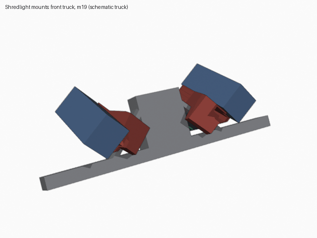
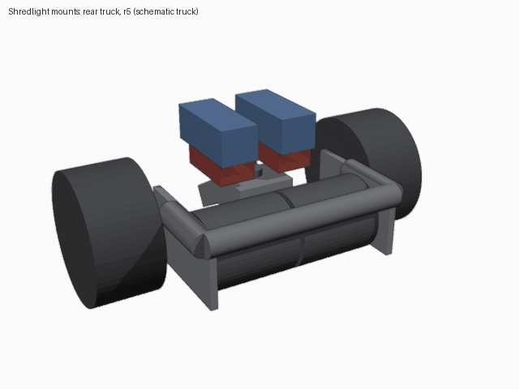
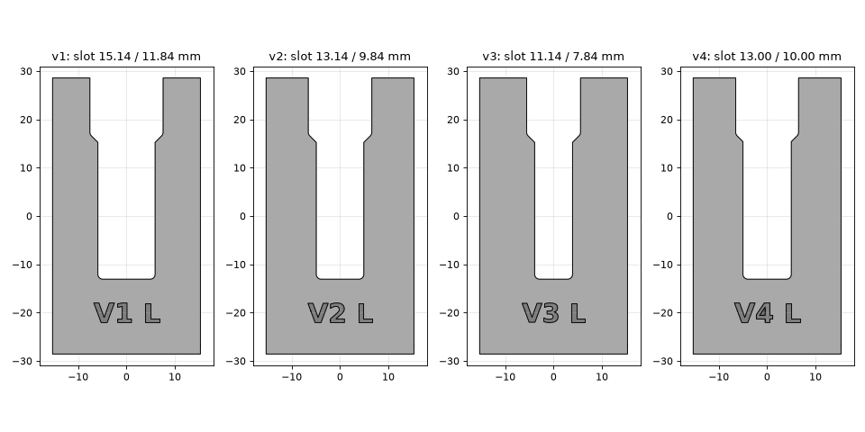
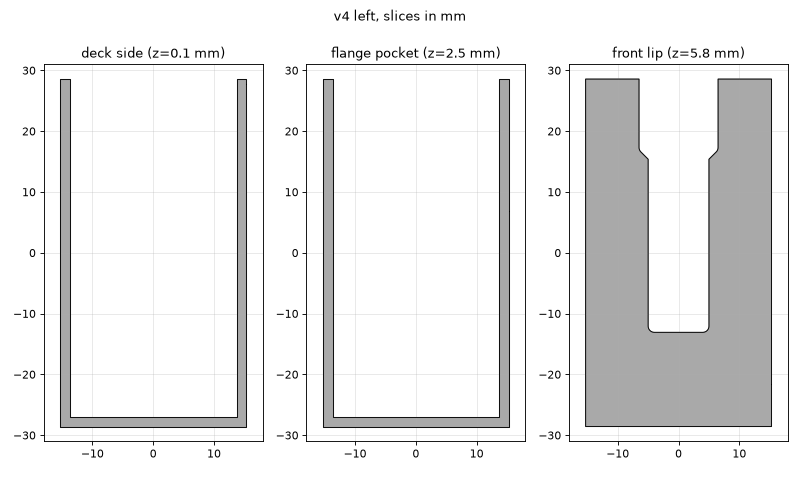

# Shredlight Mounts

3D-printable left and right receivers for [Shredlights](https://shredlights.com) **SL-300**
skateboard lights, plus mounts for them on a Radium Mach One S: a clamp on each side of the front truck, and a two-light bar over the rear truck's motors. The lights are the
male side of the connection: the light lies on the receiver's face, and its mounting tongue slides in
from the slot's open end (the end the lens points to), hugging the underside of the lip until the
barbs snap over it.

**Status: v1.0** (2026-11-16). Every part is printed and fitted on the board: the receiver (v7), the front truck clamps (m14, both sides) and the rear light mount (r5, one part, anchored in the rear truck's oval hole). The [v1.0 release](https://github.com/beadon/shredlight-mounts/releases/tag/v1.0) has the STLs to print. The version history of each part is in the roadmap below.

## See it mounted

The lights (blue boxes) on their mounts (red), on **schematic** trucks: only the parts the mounts
touch are measured; the rest are placeholder shapes.

| Front truck (m14) | Rear truck (r5) |
|---|---|
|  |  |
| [Turn it in your browser](out/truck/assembly_m14_view.stl) | [Turn it in your browser](out/rear/rear_assembly_r5_view.stl) |

The browser links open GitHub's 3D viewer (drag to turn, scroll to zoom). For colours and separate
parts, open `out/truck/assembly_m14.obj` or `out/rear/rear_assembly_r5.obj` in Blender.

## Where the files are

Ready-to-slice STLs, each exported in its print orientation (see [PRINT_SETTINGS.md](PRINT_SETTINGS.md)):

| Folder | What |
|---|---|
| [`out/`](out) | The Shredlight mount itself (the receiver the light clips into), left and right, every fit version: `shredlight_mount_{left,right}_v1`…`v7`. **v7 is the mount to print.** |
| [`out/truck/`](out/truck) | Front truck clamps: saddle and keeper per side, m6–**m16** (current; m14 is the last printed and ridden), plus `assembly_m*.obj` for Blender. |
| [`out/rear/`](out/rear) | Rear light mount: `rear_mount_r5.stl` (current) and `rear_assembly_r5.obj` for Blender. |

Older versions are in the git history. The `*_art` engraved saddles aren't in the repo: the artwork
isn't GPL (see [art/NOTICE.md](art/NOTICE.md)), so `truck_mount.py` builds them locally only.

> **Scope:** designed and fit-tested for the SL-300 only. Other Shredlights models may use
> different connectors, and supporting them is out of scope for this project.

The geometry is a copy of the stock powder-coated sheet-metal bracket, measured from
photos against a ruler and then refined by test prints. The reference photos are
[front with ruler](docs/reference/front-with-ruler.jpg) and [side, showing depth](docs/reference/side-depth.jpg).



## Shape

Approximately 30 × 57 × 6.6 mm (1-3/16 × 2-1/4 × 1/4"):

- **Front lip** (1/16"), with a U-slot that has a wide upper section, a 45° step and a narrower lower section
- **Side walls and bottom wall** (1/16"), which form a 3/16" pocket under the lip for the light's flange
- **Snap-fit barbs** (v7 and later) at the top of each arm. The light cams the arms apart as it slides in, then a flat ledge latches over it.
- **Open back.** The board closes the pocket, just as it does on the metal part. Set `BACK_SHEET = True` to close it in plastic.



## Fit versions

Each version is engraved on the front lip (e.g. `V2 L`), so a printed part can be traced back to its STL.

| Version | Slot upper / lower | Result |
|---|---|---|
| v1 | 15.14 / 11.84 mm | Photo-measured. Side-to-side play. Obsolete. |
| v2 | 13.14 / 9.84 mm | Snug, but the upper slot spreads about 1 mm when the light goes in. Stresses the part. |
| v3 | 11.14 / 7.84 mm | Too narrow. The light will not insert. |
| v4 | 13.00 / 10.00 mm | Works, but the upper slot also spreads about 1 mm. |
| v5 | 14.50 / 10.00 mm | Upper widened by the measured spread plus clearance. No deformation and snug, but it holds by friction only. |
| v6 | 14.50 / 10.00 mm | v5's fit, plus a rounded lead-in at the slot entrance and 1.5 mm fillets on the step edges. Holds less well, and the light slides out more easily. Not recommended. |
| v7 | 14.50 / 10.00 mm | v5 plus snap-fit barbs copied from the stock part: 12 mm tip-to-tip gap, flat latching ledge 5 mm below the top. Snaps in and is very secure. It only releases with the light's release mechanism. **Winner. Print this one.** |

The STLs are in [`out/`](out), in millimetres. Print `shredlight_mount_left_v7.stl` and `shredlight_mount_right_v7.stl`.

Keep the corners at the top of the slot sharp. v6 rounded them, and the light lost its grip.

v2 and v4 both spread about 1 mm, which puts the SL-300's upper tongue at about 14 mm. v5 leaves about 0.5 mm of clearance around it.

## Truck mount (Radium Mach One S): m16

A two-part clamp holds the v7 receiver on the truck. The Mach One S hanger has no mounting holes, so the clamp grips a strut directly: the diagonal "rake" above each triangular window in the hanger plate. Left and right are mirror images, one per strut.


The renders come from `render_views.py`. A three-view silhouette drawing of one mount is in [`docs/truck_views.png`](docs/truck_views.png).

- **Saddle:** an upside-down U that drops over the strut from above. Its front arm takes the screw, and its rear arm ends in a hook pocket. It carries the receiver platform.
- **Keeper:** a flat bar that slides through the window from the front, under the strut. Its rear end goes into the saddle's hook, and its front end holds the nut.
- **Receiver platform:** v7's lip, slot and barbs, **face up**, with the slot's open end toward the nose. The light sits on top, lens forward. The platform is level front to back, but **rolled 45° outboard**, so it sits low over the clamp on a solid pedestal (m9; m2–m8 used two thin webs). The pedestal is swept straight down from the saddle as printed, so its sides are vertical on the bed. The channel under the lip is open at both ends, so grit can get out; over the clamp its roof rises in 45° chamfers from each rail to a short flat bridge (m12; m9–m11 bridged the full ~27 mm from rail to rail, and the first print's bridge sagged). It's 6 mm above the flange gap and about 15 mm wide.
- **Backbone (m15):** after a couple of rides, the left m14 receiver broke in PLA, cleanly at about 45° through the rear corner of the lower rail (the rail nearest the axle beam), and the truck showed rub marks. In m14 the pedestal backed the receiver only under the saddle, so both ends of each rail hung on v7's 1.6 mm walls alone. That is the steel original's sheet thickness, too thin to cantilever in plastic, and the lower rail's rear corner was only 2.8 mm from the (schematic) beam, so the light's shaking closed the gap. m15 adds a solid backbone behind the whole receiver, deepest where it leaves the pedestal and tapering toward the nose, so there's no sharp step for a crack to start at (`BACKBONE`); thickens both rails 1.5 mm outward, full length (`RAIL_EXTRA`); and cuts the part back parallel to the beam so it stays 5 mm clear (`BEAM_CLEAR`; v7's own rail corner allows about 5.2). The receiver itself (slot, barbs, flange gap, lip) is unchanged, as are the aim, the screw path and the keeper. The beam's position under the clamp is a guess, so check the real gap on the truck.
- **Anti-rattle fin (m16):** fully seated, the clamp still rattles a little: the keeper's rear end had 0.4 mm of play all round in the hook pocket. m16 chamfers the pocket floor's inside edges (`POCKET_CHAMFER`, 1.5 mm; the keeper's bottom edges match) and puts a 90° V fin under the keeper's rear end that slides into a V groove in the hook lip (`FIN_DEPTH` 1.2 mm, `FIN_CLEAR` 0.1 mm). The screw's pull presses the keeper's end down into the V, which centres it and takes up the play: 0.15 mm up-down and side to side, down from 0.4. The lip is 1 mm thicker (`HOOK_T` 4) to keep its strength under the groove. The groove is open at the pocket's mouth, so the keeper still slides straight in; the build checks the whole slide-in path. m15 and older keepers don't fit m16 saddles, and the other way round.
- **Hardware per side:** **1× M4×20 socket-head cap screw** (3 mm hex key) and an **M4 nyloc nut**, the same M4 size used elsewhere on the board (m10; m6–m9 used M5). It's fitted and tightened **through the receiver's own slot** (with the light removed), so no access holes are needed. The head sits 6 mm deeper in the front arm than in m12, so the screw goes right through the nut even while the keeper still hangs loose at the bottom of its hook; tightened, about 7 mm of screw shows below the nut (m12's screw only touched the nut). The keeper is 5 mm thick (m1–m12: 6 mm), so the nyloc stands about 1.2 mm proud of its underside, with 1.2 mm of keeper above it. No liner: the clamp leaves 0.25 mm all round the strut, a snug PLA fit (m1–m11 left 1 mm for a rubber liner; m11 printed without one could slide about 1 mm front to back). If it buzzes or scuffs the powder coat, a layer of electrical tape inside the saddle fixes that.
- **Fitting:** drop the saddle over the strut, slide the keeper in through the window from the front until its rear end is in the hook, then fit the screw down through the slot.

The clamp fits around the strut's shape, so it can't rotate on it. The keeper is trapped inside the window, so the clamp can't slide along the strut either. Nothing depends on friction alone.

**Measured** (calipers on the front truck, 2026-11-13; photos in [`docs/reference/truck/2026-11-13/`](docs/reference/truck/2026-11-13)):
- plate 21.8 mm thick, front to back
- strut 7.66 mm across in the hanger's plane (skyward face to window face) on its angled part, and 21.8 mm front to back: a flattened hexagon. m1–m7 used ~9 mm, read from a ruler photo
- bar below the windows: 12.18 mm from its thicker section to the window cutout
- the recess around the kingpin is 50.05 mm wide at most
- strut angle in the plate: head-on photos, corrected for the 30° tilt, give 44–47°, so 45° is kept
- hanger laid flat: 65 mm from the base to the apex
- 11 mm flat on the window-side face and about 6 mm chamfers on the skyward face, both measured front to back. How far the chamfers cut into the strut isn't measured, so they're modelled shallow, so they can't bind
- window sides about 32 × 30 × 35 mm

**Hanger tilt:** the plate leans back 30° from vertical (`TILT`). This was **measured on the front truck** with a phone inclinometer (it reads 0° against a wall), with the board on level ground. It agrees with Radium's stated 30° angle and with the m6 test fit, which was also on the front truck. The rear truck isn't measured yet. m6 assumed 45°, and held in place it aimed about 15° high, which is exactly the difference. The aim follows the tilt one for one; the strut's angle within the plate (`STRUT_ANGLE`, estimated at 45°) mostly turns the beam left or right, not up or down. `PITCH_DOWN` (0) is left in for fine-tuning the aim. The 45° roll turns only the light's body about the beam; that's `ROLL`.

Files are in [`out/truck/`](out/truck):

| File | What it is |
|---|---|
| `truck_mount_{left,right}_m16_saddle.stl` | Print receiver-face down, so the lip and barbs are on the bed, as for v7. m9 is designed to need little or no support: the flange channel's roof is chamfered at 45° up to a ~15 mm bridge (m12), and the only other real overhang is the short hook lip at the top. Slice it without supports first and check the preview. |
| `truck_mount_{left,right}_m16_keeper.stl` | Prints flat with no supports, **flat top on the bed** (m16: the fin faces up; m1–m15 printed nut pocket down). The nut pocket takes an M4 nyloc nut, so earlier (M5) keepers don't fit. 5 mm thick, with the screw 1.25 mm further out: m12 and older keepers don't fit. |
| `assembly_m16.obj` (coloured, named parts, with a light-sized placeholder) and `assembly_m16_*.stl` | Both mounts on a **schematic** hanger, in mounted positions, for checking in Blender. Only the struts' cross-section is measured; the beam and pivot block are placeholder boxes. Not for printing. |

**Engraved artwork (optional):** if `art/source.png` exists, `truck_mount.py` also writes `truck_mount_{left,right}_m16_saddle_art.stl` (and `assembly_m16_art.obj`), with the picture recessed 0.6 mm into the pedestal's tail-facing wall. Each groove's upper side slopes down 45° into the wall instead of being a flat little ceiling, so the engraving needs no supports (m14; m12's grooves drew supports onto the picture). The wall is the flat, roughly 28 mm square side you see from behind the board. `artwork.py` turns the picture into black-and-white ink with every line at least 0.4 mm wide, so a 0.4 mm nozzle can cut it. It's turned to fit the tipped wall as large as it can (about 21 mm) and mirrored on the left mount. The settings are in `ART` in `truck_mount.py`. The `*_art` files are gitignored, and the artwork in `art/` is not GPL (see [its notice](art/NOTICE.md)).

Truck reference photos are in [`docs/reference/truck/`](docs/reference/truck).

**Truck angle sources:**
- Radium's Mach One description: "the R6 Trucks feature a 30 degree angle in the rear truck".
- Radium's R6 pre-order listing, quoted on the esk8.news forum (June 2023): "60 degree front, 30 degree rear pivot angle" ([thread](https://forum.esk8.news/t/radium-r6-trucks-thane-belts/77112)). The original listing (`radium-performance.com/products/radium-prototype-trucks-pre-order`) now returns 404. The measured front truck is 30°, so this listing is outdated or uses a different convention.
- A Radium photo of both trucks is kept in [`docs/reference/vendor/`](docs/reference/vendor). It is **© Radium Performance and not covered by this repo's licence**; see the [notice](docs/reference/vendor/NOTICE.md).

## Rear light mount (Radium Mach One S rear truck): r5

On the rear truck the motors hide anything clamped to the hanger, so the two rear lights sit side
by side on one bar above the motors, facing the tail. It hangs off the oval hole ("hole A") in the
floor of the hanger's pocket, just in front of the charging port
([photos](docs/reference/truck/rear-2026-11-15)). `rear_mount.py` builds it as one part (r5; r2–r4
were a shoe and a light bar bolted together):

- **Shoe:** a solid 24 mm block on a flat foot on the pocket floor, stopping short of the Ra button,
  with a plug that fills hole A. An M4×16 socket-head screw goes in from the nose side, 30° below
  level, through a captive M4 hex nut and out of the plug's rear face, under the ~2 mm lip at the
  hole's rear end. The steel shank holds the mount down, and its end presses on the back of the space
  under the lip, pulling the plug tight against the hole's front wall. Tightened, the screw's head
  sits just inside its counterbore. The r4 shoe fit hole A well.
- **Light bar:** two v7 receivers, unchanged, on plates joined by a solid bridge on top of the shoe.
  The flange channels' roofs are chamfered to ~17 mm bridges.

The receivers' undersides are 15 mm above hole A, clearing the bar behind the motors (12 mm). They
are 23 mm apart, so the 17.5 mm charging plug still fits between the lights.

To fit it: slide a plain M4 hex nut (3 mm thick; the slot fits 3.11 mm nuts with 0.3 mm to spare)
into the slot in the shoe's side. Back the screw off until its end is inside the plug, drop the plug
into hole A, and tighten the screw from the nose side until it's snug. Hardware: one M4×16
socket-head screw and one plain M4 hex nut. The nut has no nylon insert, so use a drop of removable
threadlocker.

| File (in `out/rear/`) | |
|---|---|
| `rear_mount_r5.stl` | Receiver faces down, the shoe and its plug pointing up, ready to slice. No supports: besides the two channel-roof bridges, what overhangs is the nut slot's ceiling and near-level round holes, as on the r4 shoe. |
| `rear_assembly_r5.obj` | The mount and screw on a **schematic** rear truck for Blender. Only hole A, the step to the charging port, the port's position, the motors' diameter and the bar's height are measured. |

## Printing

Slicer profile and per-part settings (supports tuned to break away cleanly): [PRINT_SETTINGS.md](PRINT_SETTINGS.md).


- **Receivers:** exported lip-down, ready to slice with no rotation. The open back faces up, so nothing needs to bridge. Set `PRINT_FACE_DOWN = False` to export them in model orientation instead.
- **Truck mount:** see the file table above. The saddle prints receiver-face down, and the keeper prints flat.
- **Material:** PETG or ASA is recommended. The 1/16" lip carries the load, and PLA creeps when left in the sun or near a hot motor.

## Building

```sh
python3 -m venv .venv
.venv/bin/pip install -r requirements.txt
.venv/bin/python shredlight_mount.py out   # receiver STLs for every version in VERSIONS
.venv/bin/python truck_mount.py out        # truck clamp STLs (out/truck/)
.venv/bin/python rear_mount.py out         # rear light mount STLs (out/rear/)
.venv/bin/python preview.py docs           # preview images
.venv/bin/python render_views.py           # shaded truck-mount renders (docs/truck_render.png)
.venv/bin/python flyaround.py              # fly-around GIFs (docs/) and the browser-view STLs (needs Blender)
.venv/bin/python slice_check.py out/truck/truck_mount_left_m16_saddle.stl  # where PrusaSlicer puts supports (needs the PrusaSlicer Flatpak)
```

All receiver dimensions are named constants, in inches, at the top of `shredlight_mount.py`. The
truck mount's constants are in millimetres, at the top of `truck_mount.py` (strut size, clamp,
screw, the platform's `ROLL`, `PITCH_DOWN` and `SLOT_POINT`). To add a receiver fit
version, add an entry to `VERSIONS`: either `{"narrow": mm}` from the measured slot, or
`{"upper": mm, "lower": mm}` for exact widths. Optional `lead_in` and `step_radius` (mm) soften the slot edges.

## Known issues

### Threadlocker on plastic parts (front clamp and rear mount)

The front clamp's joint sees heavy vibration: on the board, its M4 screw and nyloc nut rattled loose,
so the repo owner now locks them with **Loctite 243 (blue)**. The rear mount's plain M4 nut also
needs a drop of removable threadlocker (see above). The parts are thermoplastic (PLA, PETG), and
Henkel's own data sheet for 243 warns:

> This product is not normally recommended for use on plastics (particularly thermoplastic materials
> where stress cracking of the plastic could result). Users are recommended to confirm compatibility
> of the product with such substrates.
>
> — Henkel, TDS LOCTITE 243 (August 2009), [local copy](docs/reference/vendor/henkel/LOCTITE-243-TDS_COPYRIGHT-HENKEL.pdf),
> [source](https://datasheets.tdx.henkel.com/LOCTITE-243-SG-en_GL.pdf)

The liquid can wick out of the threads into the nut pocket or the screw hole, and those are the
most stressed spots on the part. Until there's a better fix:

- Use one small drop on the screw's threads where they pass through the nut, never in the plastic
  pocket, and wipe off anything that squeezes out before it cures.
- At every check, look around the nut pocket and the screw head for fine cracks or whitening.
- Alternatives made for plastic fasteners: Henkel's **Loctite 425 Assure** (a cyanoacrylate,
  [product page](https://www.henkel-adhesives.com/us/en/product/threadlockers/loctite_425.html)) or a
  pre-applied, dry-film threadlocker. Further reading on why anaerobic threadlockers crack some
  thermoplastics: [Adhesives Magazine Q&A](https://www.adhesivesmag.com/articles/96391-can-we-use-anaerobic-threadlockers-for-screws-used-in-plastics).

The likely root cause of the loosening is lost preload: the plastic under the screw head and nut
creeps under the clamp load (PLA especially, PETG less), the joint goes slack, and vibration then
works the nut. A washer, or a conical spring washer, under the head would treat the cause. The head
seat is an 8 mm bore today, so a standard M4 washer (ISO 7089: 9 mm across) doesn't fit yet; a later
version would widen the seat.

### Future: TPU damping

A printed TPU sleeve between the saddle and the strut (`LINER` > 0, as m1–m11 allowed for a rubber
liner) could absorb vibration and protect the powder coat, and a TPU bumper on the lower rail's
truck-facing corner would make any contact with the axle beam soft. Keep TPU out of the screw's
clamp path (head, front arm, keeper, nut), or it will lose preload faster.

## Roadmap

- [x] Final slot: v5 (14.5 / 10 mm)
- [x] v6 (lead-in and step fillets): holds worse, so v5 stays
- [x] v7 (v5 + snap-fit barbs): **final**. Snaps in and stays put.
- [x] Truck mount m1: closed receiver box (it would trap grit), so it was replaced by m2
- [x] Truck mount m2: modelled with the strut 32 mm across; really 22.5 mm, so it would not clamp
- [x] Truck mount m3: modelled with the strut 22.5 mm across; really ~9 mm across (22 mm is its front-to-back depth)
- [x] Truck mount m4: the receiver sat too high, and the screw-access path cut into the webs
- [x] Truck mount m5: the receiver faced forward, but the light lies *on* the platform, so it would have shone at the sky
- [x] Truck mount m6: held in place on the strut, the light aimed about 15° high (built for a 45° tilt; the truck is 30°)
- [x] Truck mount m7 (built for the 30° tilt): superseded by m8 (strut re-measured at 7.66 mm)
- [x] Truck mount m8 (strut 7.66 mm): needed supports under the saddle; superseded by m9
- [x] Truck mount m9 (solid pedestal, near support-free): M5 hardware; superseded by m10
- [x] Truck mount m10 (m9 with M4×20 socket-head screw and M4 nyloc): the pedestal left thin, fragile tabs in the strut's chamfer corners beyond the keeper's ends
- [x] Truck mount m11 (m10 with the tabs removed): left saddle test-fitted; the shape matches the strut, but the 1 mm liner gap let it slide about 1 mm front to back without a liner
- [x] Truck mount m12 (m11 with 0.25 mm clearance, no liner, and the channel roof chamfered to shorten its bridge): printed; the screw only touched the nut, because the keeper hangs ~3.4 mm low until it's pulled up, and the keeper rattled in its slot
- [x] Truck mount m13 (m12 with the head seat 6 mm deeper, screw 1.25 mm further out, keeper 6 → 5 mm)
- [x] Truck mount m14 (m13 with the keeper's hook pocket 5.8 mm tall instead of 8.4, so its rear end can't rock, and the engraving with 45° groove ceilings and a clean mesh): left saddle printed and mounted (2026-11-15). The keeper is snug, the screw catches and tightens the nut, the light snaps in, and the aim, ground and wheel clearance are fine. The ~15 mm bridge over the flange channel sags slightly, but it sits ~6 mm above the flange's path, so it doesn't affect the fit
- [x] Print the right side once the left fits: m14 right printed and mounted (2026-11-15), fits fine
- [x] Front truck's hanger tilt: measured 30° from vertical (the 2023 pre-order listing said 60° front)
- [x] Rear truck: the motors hide the hanger, so the rear lights get their own mount (`rear_mount.py`), not the strut clamp
- [x] Rear mount r1: one-piece stalk; too weak (a thin, hollow PLA neck loaded across its layers, and a PLA hook)
- [x] Rear mount r2 (shoe with an angled M4 under the lip, and a light bar bolted on): shoe printed; most of it is good, but its nut slots were sized for 5 mm nylocs, and the nuts used are plain 3.11 mm hex nuts
- [x] Rear mount r3 (r2 with nut slots for 3.11 mm nuts): shoe printed and fitted in hole A; its nose end overhung the Ra button by ~3 mm
- [x] Rear mount r4 (r3 with the shoe's nose end 3 mm shorter and the screw steeper, 30° below level, so its head still seats; an M4×16, its head hidden): shoe printed and fitted (2026-11-16), fits well
- [x] Rear mount r5 (the r4 shoe and light bar as one part, no bar bolts): printed and fitted (2026-11-16), fits perfectly
- [x] **v1.0** (2026-11-16): receiver v7, front truck clamps m14, rear light mount r5
- [x] m14 left saddle broke in PLA after a couple of rides (2026-11-21): the receiver's lower rail snapped at its rear corner, which had also rubbed the axle beam
- [x] Truck mount m15 (backbone behind the whole receiver, rails 1.5 mm thicker, 5 mm beam clearance). The clamp still rattles a little fully seated, so m16 follows
- [ ] Truck mount m16 (m15 with a V fin and groove locating the keeper in the hook pocket, and chamfered pocket edges), in PETG with an M4 spring washer under the screw head: print, fit and ride

## License

[GPL-3.0](LICENSE), except `docs/reference/vendor/`, which is © Radium Performance and, in `henkel/`, © Henkel (see its [notice](docs/reference/vendor/NOTICE.md)), and `art/`, which is Calvin and Hobbes © Bill Watterson (see its [notice](art/NOTICE.md)). Shredlights is a trademark of its owner. This project is not affiliated with or endorsed by them.
