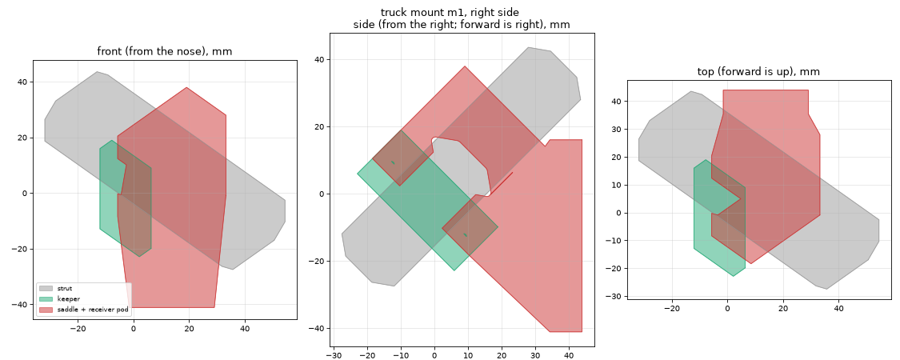

# Shredlight Mounts

3D-printable left and right receivers for [Shredlights](https://shredlights.com) **SL-300**
skateboard lights. The lights are the male side of the connection: their mounting tongue slides
down into the receiver from the open top and hugs the underside of the front lip.

> **Scope:** designed and fit-tested for the SL-300 only. Other Shredlights models may use
> different connectors, and supporting them is out of scope for this project.

The geometry is a copy of the stock powder-coated sheet-metal bracket, measured from
photos against a ruler and then refined by test prints. The reference photos are
[front with ruler](docs/reference/front-with-ruler.jpg) and [side, showing depth](docs/reference/side-depth.jpg).


## Shape

Approximately 30 × 57 × 6.6 mm (1-3/16 × 2-1/4 × 1/4"):

- **Front lip** (1/16"), with a U-slot that has a wide upper section, a 45° step and a narrower lower section
- **Side walls and bottom wall** (1/16"), which form a 3/16" pocket under the lip for the light's flange
- **Snap-fit barbs** (v7 and later) at the top of each arm. The light cams the arms apart as it slides in, then a flat ledge latches over it.
- **Open back.** The board closes the pocket, just as it does on the metal part. Set `BACK_SHEET = True` to close it in plastic.


## Fit versions

Each version is engraved on the front lip (e.g. `V2 L`), so a printed part can be traced back to its STL.

| Version | Slot upper / lower | Result |
|---|---|---|
| v1 | 15.14 / 11.84 mm | Photo-measured. Side-to-side play. Obsolete. |
| v2 | 13.14 / 9.84 mm | Snug, but the upper slot spreads about 1 mm when the light goes in. Stresses the part. |
| v3 | 11.14 / 7.84 mm | Too narrow. The light will not insert. |
| v4 | 13.00 / 10.00 mm | Works, but the upper slot also spreads about 1 mm. |
| v5 | 14.50 / 10.00 mm | Upper widened by the measured spread plus clearance. No deformation and snug, but it holds by friction only. |
| v6 | 14.50 / 10.00 mm | v5's fit, plus a rounded lead-in at the slot entrance and 1.5 mm fillets on the step edges. Holds less well, and the light slides out more easily. Not recommended. |
| v7 | 14.50 / 10.00 mm | v5 plus snap-fit barbs copied from the stock part: 12 mm tip-to-tip gap, flat latching ledge 5 mm below the top. Snaps in and is very secure. It only releases with the light's release mechanism. **Winner. Print this one.** |

The STLs are in [`out/`](out), in millimetres. Print `shredlight_mount_left_v7.stl` and `shredlight_mount_right_v7.stl`.

Keep the corners at the top of the slot sharp. v6 rounded them, and the light lost its grip.

v2 and v4 both spread about 1 mm, which puts the SL-300's upper tongue at about 14 mm. v5 leaves about 0.5 mm of clearance around it.

## Truck mount (Radium Mach One S): prototype m1

A two-part clamp holds the v7 receiver on the truck. The Mach One S hanger has no mounting holes, so the clamp grips a strut directly: the diagonal "rake" above each triangular window in the hanger plate. Left and right are mirror images, one per strut.



- **Saddle:** an upside-down U that drops over the strut from above. It carries a 45° wedge and the receiver pod, so the light sits level and points forward.
- **Keeper:** a flat bar that slides through the window under the strut.
- **Hardware per side:** 2× M4×40 socket-head screws and 2× M4 nyloc nuts, one screw in front of the plate and one behind. Add a 1 mm TPU or rubber liner between the clamp and the strut to damp vibration and protect the finish.

The clamp fits around the strut's shape, so it can't rotate on it. The keeper is trapped inside the window, so the clamp can't slide along the strut either. Nothing depends on friction alone.

**Measured:**
- plate 22 mm thick
- strut 32 mm from the window face to the skyward face
- 11 mm flat on the window-side face, about 6 mm chamfers on the skyward face
- window sides about 32 × 30 × 35 mm

**Assumed, to be checked on the first print:** the plate is tilted back 45°, and the strut rises at 45° in the plate's plane. Check that the receiver sits level once it's mounted. The angles are `TILT` and `STRUT_ANGLE` in `truck_mount.py`.

Files are in [`out/truck/`](out/truck):

| File | What it is |
|---|---|
| `truck_mount_{left,right}_m1_saddle.stl` | Print receiver-face down. The clamp section needs supports. |
| `truck_mount_{left,right}_m1_keeper.stl` | Prints flat with no supports. The nut pockets are on the bed side. |
| `*_assembly_*.stl`, `reference_strut_right.stl` | The parts in their mounted positions, for checking fit in Blender. Not for printing. |

Truck reference photos are in [`docs/reference/truck/`](docs/reference/truck).

## Printing

- The STLs are exported lip-down, ready to slice with no rotation. The open back faces up, so nothing needs to bridge. Set `PRINT_FACE_DOWN = False` to export them in model orientation instead.
- PETG or ASA is recommended. The 1/16" lip carries the load, and PLA creeps when left in the sun.

## Building

```sh
python3 -m venv .venv
.venv/bin/pip install -r requirements.txt
.venv/bin/python shredlight_mount.py out   # receiver STLs for every version in VERSIONS
.venv/bin/python truck_mount.py out        # truck clamp STLs (out/truck/)
.venv/bin/python preview.py docs           # preview images
```

All dimensions are named constants, in inches, at the top of `shredlight_mount.py`. To add a fit
version, add an entry to `VERSIONS`: either `{"narrow": mm}` from the measured slot, or
`{"upper": mm, "lower": mm}` for exact widths. Optional `lead_in` and `step_radius` (mm) soften the slot edges.

## Roadmap

- [x] Final slot: v5 (14.5 / 10 mm)
- [x] v6 (lead-in and step fillets): holds worse, so v5 stays
- [x] v7 (v5 + snap-fit barbs): **final**. Snaps in and stays put.
- [ ] Truck mount m1: test-fit the clamp, check the receiver is level, check ground and wheel clearance

## License

[GPL-3.0](LICENSE). Shredlights is a trademark of its owner. This project is not affiliated with or endorsed by them.
