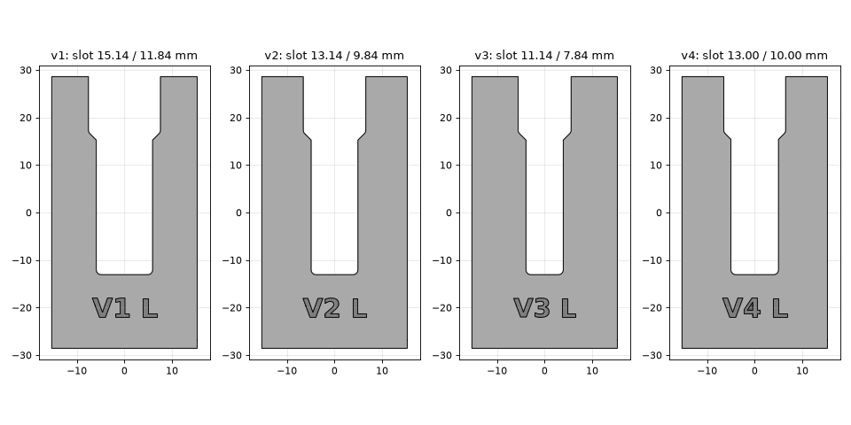
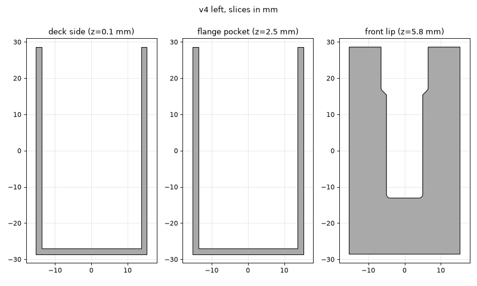
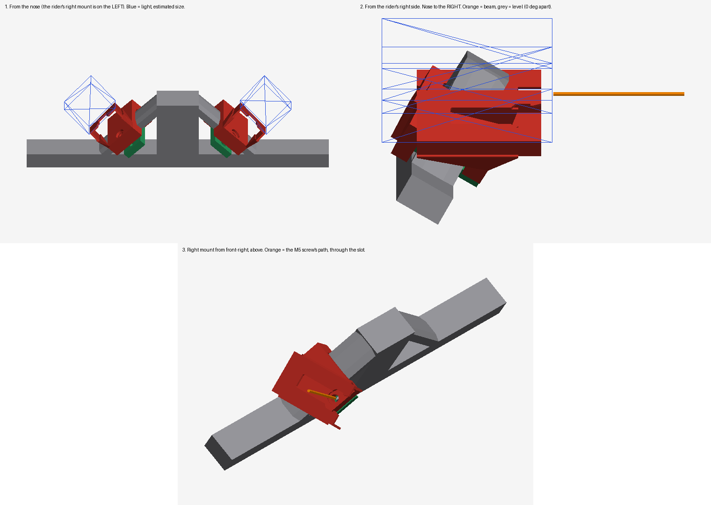

# Shredlight Mounts

3D-printable left and right receivers for [Shredlights](https://shredlights.com) **SL-300**
skateboard lights, plus a clamp that mounts them on Radium Mach One S trucks. The lights are the
male side of the connection: the light lies on the receiver's face, and its mounting tongue slides in
from the slot's open end (the end the lens points to), hugging the underside of the lip until the
barbs snap over it.

**Status:** the receiver is final (v7). The truck mount is at prototype m7: m6 aimed about 15° high when held in place, which a 30° hanger tilt (Radium's stated truck angle) accounts for, so m7 is built for 30°.

> **Scope:** designed and fit-tested for the SL-300 only. Other Shredlights models may use
> different connectors, and supporting them is out of scope for this project.

The geometry is a copy of the stock powder-coated sheet-metal bracket, measured from
photos against a ruler and then refined by test prints. The reference photos are
[front with ruler](docs/reference/front-with-ruler.jpg) and [side, showing depth](docs/reference/side-depth.jpg).



## Shape

Approximately 30 × 57 × 6.6 mm (1-3/16 × 2-1/4 × 1/4"):

- **Front lip** (1/16"), with a U-slot that has a wide upper section, a 45° step and a narrower lower section
- **Side walls and bottom wall** (1/16"), which form a 3/16" pocket under the lip for the light's flange
- **Snap-fit barbs** (v7 and later) at the top of each arm. The light cams the arms apart as it slides in, then a flat ledge latches over it.
- **Open back.** The board closes the pocket, just as it does on the metal part. Set `BACK_SHEET = True` to close it in plastic.



## Fit versions

Each version is engraved on the front lip (e.g. `V2 L`), so a printed part can be traced back to its STL.

| Version | Slot upper / lower | Result |
|---|---|---|
| v1 | 15.14 / 11.84 mm | Photo-measured. Side-to-side play. Obsolete. |
| v2 | 13.14 / 9.84 mm | Snug, but the upper slot spreads about 1 mm when the light goes in. Stresses the part. |
| v3 | 11.14 / 7.84 mm | Too narrow. The light will not insert. |
| v4 | 13.00 / 10.00 mm | Works, but the upper slot also spreads about 1 mm. |
| v5 | 14.50 / 10.00 mm | Upper widened by the measured spread plus clearance. No deformation and snug, but it holds by friction only. |
| v6 | 14.50 / 10.00 mm | v5's fit, plus a rounded lead-in at the slot entrance and 1.5 mm fillets on the step edges. Holds less well, and the light slides out more easily. Not recommended. |
| v7 | 14.50 / 10.00 mm | v5 plus snap-fit barbs copied from the stock part: 12 mm tip-to-tip gap, flat latching ledge 5 mm below the top. Snaps in and is very secure. It only releases with the light's release mechanism. **Winner. Print this one.** |

The STLs are in [`out/`](out), in millimetres. Print `shredlight_mount_left_v7.stl` and `shredlight_mount_right_v7.stl`.

Keep the corners at the top of the slot sharp. v6 rounded them, and the light lost its grip.

v2 and v4 both spread about 1 mm, which puts the SL-300's upper tongue at about 14 mm. v5 leaves about 0.5 mm of clearance around it.

## Truck mount (Radium Mach One S): prototype m7

A two-part clamp holds the v7 receiver on the truck. The Mach One S hanger has no mounting holes, so the clamp grips a strut directly: the diagonal "rake" above each triangular window in the hanger plate. Left and right are mirror images, one per strut.



The renders come from `render_views.py`. A three-view silhouette drawing of one mount is in [`docs/truck_views.png`](docs/truck_views.png).

- **Saddle:** an upside-down U that drops over the strut from above. Its front arm takes the screw, and its rear arm ends in a hook pocket. It carries the receiver platform.
- **Keeper:** a flat bar that slides through the window from the front, under the strut. Its rear end goes into the saddle's hook, and its front end holds the nut.
- **Receiver platform:** v7's lip, slot and barbs, **face up**, with the slot's open end toward the nose. The light sits on top, lens forward. The platform is level front to back, but **rolled 45° outboard**, so it sits low over the clamp with two webs underneath. The channel under the lip is open at both ends, so grit can get out.
- **Hardware per side:** **1× M5×20 socket-head screw** and an M5 nyloc nut. It's fitted and tightened **through the receiver's own slot** (with the light removed), so no access holes are needed. Add a 1 mm TPU or rubber liner between the clamp and the strut.
- **Fitting:** drop the saddle over the strut, slide the keeper in through the window from the front until its rear end is in the hook, then fit the screw down through the slot.

The clamp fits around the strut's shape, so it can't rotate on it. The keeper is trapped inside the window, so the clamp can't slide along the strut either. Nothing depends on friction alone.

**Measured:**
- plate 22 mm thick
- strut ~9 mm across in the hanger's plane (skyward face to window face) and 22 mm front to back: a flattened hexagon
- hanger laid flat: 65 mm from the base to the apex
- 11 mm flat on the window-side face and about 6 mm chamfers on the skyward face, both measured front to back. How far the chamfers cut into the 9 mm isn't measured, so they're modelled shallow, so they can't bind
- window sides about 32 × 30 × 35 mm

**Hanger tilt:** the plate leans back 30° from vertical (`TILT`). Radium gives the R6 rear truck a 30° angle, and that matches the m6 test fit. m6 assumed 45°, and held in place it aimed about 15° high, which is exactly the difference. The aim follows the tilt one for one; the strut's angle within the plate (`STRUT_ANGLE`, estimated at 45°) mostly turns the beam left or right, not up or down. `PITCH_DOWN` (0) is left in for fine-tuning the aim. The 45° roll turns only the light's body about the beam; that's `ROLL`.

Files are in [`out/truck/`](out/truck):

| File | What it is |
|---|---|
| `truck_mount_{left,right}_m7_saddle.stl` | Print receiver-face down, so the lip and barbs are on the bed, as for v7. Use **tree supports, touching the build plate only**, with the overhang threshold around 40°. Many clamp faces sit at exactly 45°, so this keeps them from being supported. |
| `truck_mount_{left,right}_m7_keeper.stl` | Prints flat with no supports. The nut pocket is on the bed side. Unchanged since m6, so a printed m6 keeper works with m7. |
| `assembly_m7.obj` (coloured, named parts, with a light-sized placeholder) and `assembly_m7_*.stl` | Both mounts on a **schematic** hanger, in mounted positions, for checking in Blender. Only the struts' cross-section is measured; the beam and pivot block are placeholder boxes. Not for printing. |

Truck reference photos are in [`docs/reference/truck/`](docs/reference/truck).

## Printing

- **Receivers:** exported lip-down, ready to slice with no rotation. The open back faces up, so nothing needs to bridge. Set `PRINT_FACE_DOWN = False` to export them in model orientation instead.
- **Truck mount:** see the file table above. The saddle prints receiver-face down with tree supports, and the keeper prints flat.
- **Material:** PETG or ASA is recommended. The 1/16" lip carries the load, and PLA creeps when left in the sun or near a hot motor.

## Building

```sh
python3 -m venv .venv
.venv/bin/pip install -r requirements.txt
.venv/bin/python shredlight_mount.py out   # receiver STLs for every version in VERSIONS
.venv/bin/python truck_mount.py out        # truck clamp STLs (out/truck/)
.venv/bin/python preview.py docs           # preview images
.venv/bin/python render_views.py           # shaded truck-mount renders (docs/truck_render.png)
```

All receiver dimensions are named constants, in inches, at the top of `shredlight_mount.py`. The
truck mount's constants are in millimetres, at the top of `truck_mount.py` (strut size, clamp,
screw, the platform's `ROLL`, `PITCH_DOWN` and `SLOT_POINT`). To add a receiver fit
version, add an entry to `VERSIONS`: either `{"narrow": mm}` from the measured slot, or
`{"upper": mm, "lower": mm}` for exact widths. Optional `lead_in` and `step_radius` (mm) soften the slot edges.

## Roadmap

- [x] Final slot: v5 (14.5 / 10 mm)
- [x] v6 (lead-in and step fillets): holds worse, so v5 stays
- [x] v7 (v5 + snap-fit barbs): **final**. Snaps in and stays put.
- [x] Truck mount m1: closed receiver box (it would trap grit), so it was replaced by m2
- [x] Truck mount m2: modelled with the strut 32 mm across; really 22.5 mm, so it would not clamp
- [x] Truck mount m3: modelled with the strut 22.5 mm across; really ~9 mm across (22 mm is its front-to-back depth)
- [x] Truck mount m4: the receiver sat too high, and the screw-access path cut into the webs
- [x] Truck mount m5: the receiver faced forward, but the light lies *on* the platform, so it would have shone at the sky
- [x] Truck mount m6: held in place on the strut, the light aimed about 15° high (built for a 45° tilt; the truck is 30°)
- [ ] Truck mount m7 (built for the 30° tilt): check the aim, test-fit the clamp and hook, check that the screw goes in through the slot and tightens, check that the light snaps in, and check ground and wheel clearance
- [ ] Print the right side once the left fits

## License

[GPL-3.0](LICENSE). Shredlights is a trademark of its owner. This project is not affiliated with or endorsed by them.
