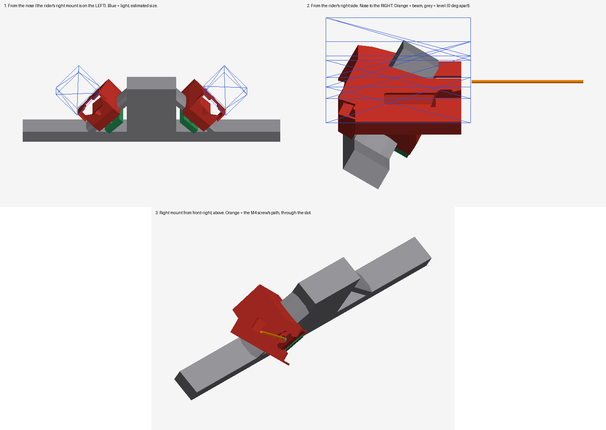

# Shredlight Mounts

3D-printable left and right receivers for [Shredlights](https://shredlights.com) **SL-300**
skateboard lights, plus a clamp that mounts them on Radium Mach One S trucks. The lights are the
male side of the connection: the light lies on the receiver's face, and its mounting tongue slides in
from the slot's open end (the end the lens points to), hugging the underside of the lip until the
barbs snap over it.

**Status:** the receiver is final (v7). The truck mount is at prototype m13: the m9 solid pedestal (almost no supports) with M4 hardware (m10) to match the rest of the board, without the thin tabs m9/m10 left at the strut channel's mouth (m11), a snug 0.25 mm fit on the strut with no liner and a chamfered channel roof (m12), and a screw that reaches through the nut before it's tightened, with a thinner keeper held snugly in its hook (m13). The strut was re-measured at 7.66 mm for m8 (2026-11-13).

> **Scope:** designed and fit-tested for the SL-300 only. Other Shredlights models may use
> different connectors, and supporting them is out of scope for this project.

The geometry is a copy of the stock powder-coated sheet-metal bracket, measured from
photos against a ruler and then refined by test prints. The reference photos are
[front with ruler](docs/reference/front-with-ruler.jpg) and [side, showing depth](docs/reference/side-depth.jpg).


## Shape

Approximately 30 × 57 × 6.6 mm (1-3/16 × 2-1/4 × 1/4"):

- **Front lip** (1/16"), with a U-slot that has a wide upper section, a 45° step and a narrower lower section
- **Side walls and bottom wall** (1/16"), which form a 3/16" pocket under the lip for the light's flange
- **Snap-fit barbs** (v7 and later) at the top of each arm. The light cams the arms apart as it slides in, then a flat ledge latches over it.
- **Open back.** The board closes the pocket, just as it does on the metal part. Set `BACK_SHEET = True` to close it in plastic.


## Fit versions

Each version is engraved on the front lip (e.g. `V2 L`), so a printed part can be traced back to its STL.

| Version | Slot upper / lower | Result |
|---|---|---|
| v1 | 15.14 / 11.84 mm | Photo-measured. Side-to-side play. Obsolete. |
| v2 | 13.14 / 9.84 mm | Snug, but the upper slot spreads about 1 mm when the light goes in. Stresses the part. |
| v3 | 11.14 / 7.84 mm | Too narrow. The light will not insert. |
| v4 | 13.00 / 10.00 mm | Works, but the upper slot also spreads about 1 mm. |
| v5 | 14.50 / 10.00 mm | Upper widened by the measured spread plus clearance. No deformation and snug, but it holds by friction only. |
| v6 | 14.50 / 10.00 mm | v5's fit, plus a rounded lead-in at the slot entrance and 1.5 mm fillets on the step edges. Holds less well, and the light slides out more easily. Not recommended. |
| v7 | 14.50 / 10.00 mm | v5 plus snap-fit barbs copied from the stock part: 12 mm tip-to-tip gap, flat latching ledge 5 mm below the top. Snaps in and is very secure. It only releases with the light's release mechanism. **Winner. Print this one.** |

The STLs are in [`out/`](out), in millimetres. Print `shredlight_mount_left_v7.stl` and `shredlight_mount_right_v7.stl`.

Keep the corners at the top of the slot sharp. v6 rounded them, and the light lost its grip.

v2 and v4 both spread about 1 mm, which puts the SL-300's upper tongue at about 14 mm. v5 leaves about 0.5 mm of clearance around it.

## Truck mount (Radium Mach One S): prototype m13

A two-part clamp holds the v7 receiver on the truck. The Mach One S hanger has no mounting holes, so the clamp grips a strut directly: the diagonal "rake" above each triangular window in the hanger plate. Left and right are mirror images, one per strut.



The renders come from `render_views.py`. A three-view silhouette drawing of one mount is in [`docs/truck_views.png`](docs/truck_views.png).

- **Saddle:** an upside-down U that drops over the strut from above. Its front arm takes the screw, and its rear arm ends in a hook pocket. It carries the receiver platform.
- **Keeper:** a flat bar that slides through the window from the front, under the strut. Its rear end goes into the saddle's hook, and its front end holds the nut.
- **Receiver platform:** v7's lip, slot and barbs, **face up**, with the slot's open end toward the nose. The light sits on top, lens forward. The platform is level front to back, but **rolled 45° outboard**, so it sits low over the clamp on a solid pedestal (m9; m2–m8 used two thin webs). The pedestal is swept straight down from the saddle as printed, so its sides are vertical on the bed. The channel under the lip is open at both ends, so grit can get out; over the clamp its roof rises in 45° chamfers from each rail to a short flat bridge (m12; m9–m11 bridged the full ~27 mm from rail to rail, and the first print's bridge sagged). It's 6 mm above the flange gap and about 15 mm wide.
- **Hardware per side:** **1× M4×20 socket-head cap screw** (3 mm hex key) and an **M4 nyloc nut**, the same M4 size used elsewhere on the board (m10; m6–m9 used M5). It's fitted and tightened **through the receiver's own slot** (with the light removed), so no access holes are needed. The head sits 6 mm deeper in the front arm than in m12, so the screw goes right through the nut even while the keeper still hangs loose at the bottom of its hook; tightened, about 7 mm of screw shows below the nut (m12's screw only touched the nut). The keeper is 5 mm thick (m1–m12: 6 mm), so the nyloc stands about 1.2 mm proud of its underside, with 1.2 mm of keeper above it. No liner: the clamp leaves 0.25 mm all round the strut, a snug PLA fit (m1–m11 left 1 mm for a rubber liner; m11 printed without one could slide about 1 mm front to back). If it buzzes or scuffs the powder coat, a layer of electrical tape inside the saddle fixes that.
- **Fitting:** drop the saddle over the strut, slide the keeper in through the window from the front until its rear end is in the hook, then fit the screw down through the slot.

The clamp fits around the strut's shape, so it can't rotate on it. The keeper is trapped inside the window, so the clamp can't slide along the strut either. Nothing depends on friction alone.

**Measured** (calipers on the front truck, 2026-11-13; photos in [`docs/reference/truck/2026-11-13/`](docs/reference/truck/2026-11-13)):
- plate 21.8 mm thick, front to back
- strut 7.66 mm across in the hanger's plane (skyward face to window face) on its angled part, and 21.8 mm front to back: a flattened hexagon. m1–m7 used ~9 mm, read from a ruler photo
- bar below the windows: 12.18 mm from its thicker section to the window cutout
- the recess around the kingpin is 50.05 mm wide at most
- strut angle in the plate: head-on photos, corrected for the 30° tilt, give 44–47°, so 45° is kept
- hanger laid flat: 65 mm from the base to the apex
- 11 mm flat on the window-side face and about 6 mm chamfers on the skyward face, both measured front to back. How far the chamfers cut into the strut isn't measured, so they're modelled shallow, so they can't bind
- window sides about 32 × 30 × 35 mm

**Hanger tilt:** the plate leans back 30° from vertical (`TILT`). This was **measured on the front truck** with a phone inclinometer (it reads 0° against a wall), with the board on level ground. It agrees with Radium's stated 30° angle and with the m6 test fit, which was also on the front truck. The rear truck isn't measured yet. m6 assumed 45°, and held in place it aimed about 15° high, which is exactly the difference. The aim follows the tilt one for one; the strut's angle within the plate (`STRUT_ANGLE`, estimated at 45°) mostly turns the beam left or right, not up or down. `PITCH_DOWN` (0) is left in for fine-tuning the aim. The 45° roll turns only the light's body about the beam; that's `ROLL`.

Files are in [`out/truck/`](out/truck):

| File | What it is |
|---|---|
| `truck_mount_{left,right}_m13_saddle.stl` | Print receiver-face down, so the lip and barbs are on the bed, as for v7. m9 is designed to need little or no support: the flange channel's roof is chamfered at 45° up to a ~15 mm bridge (m12), and the only other real overhang is the short hook lip at the top. Slice it without supports first and check the preview. |
| `truck_mount_{left,right}_m13_keeper.stl` | Prints flat with no supports. The nut pocket is on the bed side and takes an M4 nyloc nut, so earlier (M5) keepers don't fit. 5 mm thick, with the screw 1.25 mm further out: m12 and older keepers don't fit. |
| `assembly_m13.obj` (coloured, named parts, with a light-sized placeholder) and `assembly_m13_*.stl` | Both mounts on a **schematic** hanger, in mounted positions, for checking in Blender. Only the struts' cross-section is measured; the beam and pivot block are placeholder boxes. Not for printing. |

**Engraved artwork (optional):** if `art/source.png` exists, `truck_mount.py` also writes `truck_mount_{left,right}_m13_saddle_art.stl` (and `assembly_m13_art.obj`), with the picture recessed 0.6 mm into the pedestal's tail-facing wall. Each groove's upper side slopes down 45° into the wall instead of being a flat little ceiling, so the engraving needs no supports (m13; m12's grooves drew supports onto the picture). The wall is the flat, roughly 28 mm square side you see from behind the board. `artwork.py` turns the picture into black-and-white ink with every line at least 0.4 mm wide, so a 0.4 mm nozzle can cut it. It's turned to fit the tipped wall as large as it can (about 21 mm) and mirrored on the left mount. The settings are in `ART` in `truck_mount.py`. The `*_art` files are gitignored, and the artwork in `art/` is not GPL (see [its notice](art/NOTICE.md)).

Truck reference photos are in [`docs/reference/truck/`](docs/reference/truck).

**Truck angle sources:**
- Radium's Mach One description: "the R6 Trucks feature a 30 degree angle in the rear truck".
- Radium's R6 pre-order listing, quoted on the esk8.news forum (June 2023): "60 degree front, 30 degree rear pivot angle" ([thread](https://forum.esk8.news/t/radium-r6-trucks-thane-belts/77112)). The original listing (`radium-performance.com/products/radium-prototype-trucks-pre-order`) now returns 404. The measured front truck is 30°, so this listing is outdated or uses a different convention.
- A Radium photo of both trucks is kept in [`docs/reference/vendor/`](docs/reference/vendor). It is **© Radium Performance and not covered by this repo's licence**; see the [notice](docs/reference/vendor/NOTICE.md).

## Printing

- **Receivers:** exported lip-down, ready to slice with no rotation. The open back faces up, so nothing needs to bridge. Set `PRINT_FACE_DOWN = False` to export them in model orientation instead.
- **Truck mount:** see the file table above. The saddle prints receiver-face down, and the keeper prints flat.
- **Material:** PETG or ASA is recommended. The 1/16" lip carries the load, and PLA creeps when left in the sun or near a hot motor.

## Building

```sh
python3 -m venv .venv
.venv/bin/pip install -r requirements.txt
.venv/bin/python shredlight_mount.py out   # receiver STLs for every version in VERSIONS
.venv/bin/python truck_mount.py out        # truck clamp STLs (out/truck/)
.venv/bin/python preview.py docs           # preview images
.venv/bin/python render_views.py           # shaded truck-mount renders (docs/truck_render.png)
```

All receiver dimensions are named constants, in inches, at the top of `shredlight_mount.py`. The
truck mount's constants are in millimetres, at the top of `truck_mount.py` (strut size, clamp,
screw, the platform's `ROLL`, `PITCH_DOWN` and `SLOT_POINT`). To add a receiver fit
version, add an entry to `VERSIONS`: either `{"narrow": mm}` from the measured slot, or
`{"upper": mm, "lower": mm}` for exact widths. Optional `lead_in` and `step_radius` (mm) soften the slot edges.

## Roadmap

- [x] Final slot: v5 (14.5 / 10 mm)
- [x] v6 (lead-in and step fillets): holds worse, so v5 stays
- [x] v7 (v5 + snap-fit barbs): **final**. Snaps in and stays put.
- [x] Truck mount m1: closed receiver box (it would trap grit), so it was replaced by m2
- [x] Truck mount m2: modelled with the strut 32 mm across; really 22.5 mm, so it would not clamp
- [x] Truck mount m3: modelled with the strut 22.5 mm across; really ~9 mm across (22 mm is its front-to-back depth)
- [x] Truck mount m4: the receiver sat too high, and the screw-access path cut into the webs
- [x] Truck mount m5: the receiver faced forward, but the light lies *on* the platform, so it would have shone at the sky
- [x] Truck mount m6: held in place on the strut, the light aimed about 15° high (built for a 45° tilt; the truck is 30°)
- [x] Truck mount m7 (built for the 30° tilt): superseded by m8 (strut re-measured at 7.66 mm)
- [x] Truck mount m8 (strut 7.66 mm): needed supports under the saddle; superseded by m9
- [x] Truck mount m9 (solid pedestal, near support-free): M5 hardware; superseded by m10
- [x] Truck mount m10 (m9 with M4×20 socket-head screw and M4 nyloc): the pedestal left thin, fragile tabs in the strut's chamfer corners beyond the keeper's ends
- [x] Truck mount m11 (m10 with the tabs removed): left saddle test-fitted; the shape matches the strut, but the 1 mm liner gap let it slide about 1 mm front to back without a liner
- [x] Truck mount m12 (m11 with 0.25 mm clearance, no liner, and the channel roof chamfered to shorten its bridge): printed; the screw only touched the nut, because the keeper hangs ~3.4 mm low until it's pulled up, and the keeper rattled in its slot
- [ ] Truck mount m13 (m12 with the head seat 6 mm deeper, screw 1.25 mm further out, keeper 6 → 5 mm, and the keeper's hook pocket 5.8 mm tall instead of 8.4, so its rear end can't rock; engraving with 45° groove ceilings and a clean mesh): test-fit the clamp and hook, check that the screw goes in through the slot and tightens, check that the light snaps in, check the aim, and check ground and wheel clearance
- [ ] Print the right side once the left fits
- [x] Front truck's hanger tilt: measured 30° from vertical (the 2023 pre-order listing said 60° front)
- [ ] Measure the rear truck's hanger tilt the same way before mounting lights there; if it isn't 30°, build that saddle with its own `TILT`

## License

[GPL-3.0](LICENSE), except `docs/reference/vendor/`, which is © Radium Performance (see its [notice](docs/reference/vendor/NOTICE.md)), and `art/`, which is Calvin and Hobbes © Bill Watterson (see its [notice](art/NOTICE.md)). Shredlights is a trademark of its owner. This project is not affiliated with or endorsed by them.
